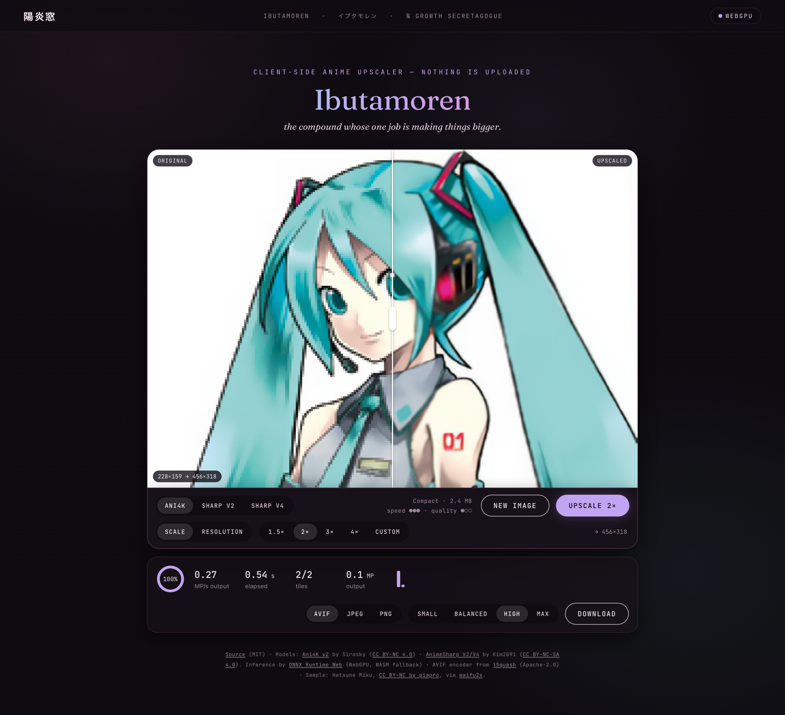

# Ibutamoren

Ibutamoren upscales anime images locally in the browser, using WebGPU or multithreaded WebAssembly. Tiled inference supports large images, arbitrary target sizes, and AVIF, HEIC, JPEG or PNG export. Images stay on your machine.

[Open Ibutamoren](https://kagerou.glass/ibutamoren/)

## Highlights

- Upscale locally in the browser; images stay on your machine.
- Choose a target size instead of being limited to a fixed enlargement factor.
- Use tiled inference for large images and GPU or CPU execution.

Full feature list

- WebGPU, multithreaded WebAssembly, and single-threaded WebAssembly backends.
- Arbitrary target scale or resolution with tiled inference.
- AVIF, HEIC, JPEG, and PNG export.
- Ani4K v2 (2.4 MB), AnimeSharp V2 (8.8 MB), and AnimeSharp V4 Fast (32 MB).
- URL presets: `?model=ani4k|animesharp|animesharp4`, `?scale=2.5`, and `?res=1440`.

## Notes

- A browser with WebGPU or WebAssembly; local hosting: `python3 serve.py`.
- Threaded WASM requires cross-origin isolation headers; other hosts use WebGPU or single-threaded WASM. [Inference reference](REFERENCE.md).
- Bundled models restrict the shipped app to noncommercial use. [Model authors and licenses](models/README.md) · [Third-party notices](THIRD_PARTY_NOTICES.md).
